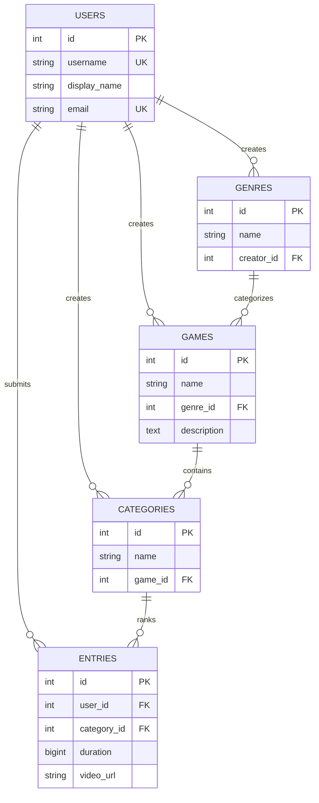

# Speedrun Leaderboard REST API

RESTful API backend untuk platform catatan rekor kecepatan game (*speedrun leaderboard*). Proyek ini dibangun menggunakan **Python Flask** dan **PostgreSQL (Supabase)**, serta siap di-deploy secara serverless ke **Vercel**.

---

## Fitur Utama

1. **CRUD Games (`/api/games`)**:
   - `GET /api/games`: Mengambil daftar game beserta genre dan deskripsinya (mendukung pencarian `?search=` dan filter `?genre_id=`).
   - `GET /api/games/<id>`: Mengambil detail satu game beserta kategori speedrun yang tersedia.
   - `POST /api/games`: Menambahkan game baru (validasi nama & genre_id).
   - `PUT /api/games/<id>`: Memperbarui data game.
   - `DELETE /api/games/<id>`: Menghapus game (dilengkapi proteksi integritas: jika game masih memiliki kategori, mengembalikan status 409 Conflict).
2. **Master Data & Leaderboard**:
   - `GET /api/genres`: Mengambil daftar genre game.
   - `GET /api/categories`: Mengambil kategori speedrun.
   - `GET /api/leaderboard`: Mengambil daftar rekor lari speedrun lengkap (runner, game, kategori, durasi waktu, dan link video bukti).
3. **Health Check & Monitoring**:
   - `GET /api/health`: Memeriksa status kesehatan server dan koneksi database.

---

## Diagram Relasi Basis Data (ERD)

Struktur tabel relasional utama pada file `Proyek Speedrun.sql`:



---

## Struktur Folder Proyek

```text
speedrunweb-be/
├── api/
│   ├── index.py              # Entrypoint Flask WSGI untuk Vercel
│   └── db.py                 # Koneksi database PostgreSQL + fallback mock data
├── .env.example              # Template variabel lingkungan
├── .gitignore                # File yang diabaikan Git
├── app.py                    # Runner aplikasi lokal
├── postman_collection.json   # Koleksi pengujian Postman siap impor
├── Proyek Speedrun.sql       # Skema DDL tabel database
├── seed.sql                  # Data awal (dummy data) untuk testing
├── requirements.txt          # Library dependencies
├── vercel.json               # Konfigurasi routing serverless Vercel
└── README.md                 # Dokumentasi proyek
```

---

## Panduan Menjalankan Secara Lokal

1. **Clone Repositori**:
   ```bash
   git clone https://github.com/firm65nsyah/speedrunweb-be.git
   cd speedrunweb-be
   ```

2. **Buat Virtual Environment & Install Dependencies**:
   ```bash
   python -m venv venv
   # Di Windows:
   venv\Scripts\activate
   # Di Mac/Linux:
   source venv/bin/activate

   pip install -r requirements.txt
   ```

3. **Konfigurasi Lingkungan (Opsional)**:
   Buat file `.env` dari contoh `.env.example`:
   ```bash
   cp .env.example .env
   ```
   *Catatan: Jika `DATABASE_URL` tidak diisi, API akan otomatis menggunakan data in-memory mock sehingga tetap bisa diuji tanpa konfigurasi database.*

4. **Jalankan Server Lokal**:
   ```bash
   python app.py
   ```
   Aplikasi akan berjalan di: `http://127.0.0.1:5000`

---

## Panduan Deployment ke Vercel

1. Buka [Vercel Dashboard](https://vercel.com) dan login.
2. Klik **Add New...** -> **Project**.
3. Import repositori GitHub `speedrunweb-be`.
4. (Opsional) Pada bagian **Environment Variables**, tambahkan:
   - Key: `DATABASE_URL`
   - Value: Connection string PostgreSQL dari Supabase Anda.
5. Klik **Deploy**.

---

## Daftar Endpoint REST API

| Method | Endpoint | Deskripsi | Status Code |
| :--- | :--- | :--- | :---: |
| `GET` | `/` | Informasi root & daftar rute API | 200 |
| `GET` | `/api/health` | Status server & koneksi database | 200 |
| `GET` | `/api/genres` | Mengambil semua genre game | 200 |
| `GET` | `/api/categories` | Mengambil semua kategori speedrun | 200 |
| `GET` | `/api/leaderboard` | Mengambil catatan rekor leaderboard | 200 |
| `GET` | `/api/games` | Mengambil daftar game (`?search=` / `?genre_id=`) | 200 |
| `GET` | `/api/games/<id>` | Mengambil detail game beserta kategorinya | 200 / 404 |
| `POST` | `/api/games` | Menambahkan game baru | 201 / 400 |
| `PUT` | `/api/games/<id>` | Mengupdate data game | 200 / 404 |
| `DELETE` | `/api/games/<id>` | Menghapus game (proteksi foreign key) | 200 / 404 / 409 |

### Contoh Request Body `POST /api/games`
```json
{
  "name": "Hades",
  "genre_id": 2,
  "description": "Rogue-like action dungeon crawler karya Supergiant Games."
}
```

---

## Pengujian dengan Postman

File koleksi `postman_collection.json` sudah disediakan di root repositori:
1. Buka Postman / Thunder Client.
2. Klik tombol **Import** dan pilih file `postman_collection.json`.
3. Set variable `{{baseUrl}}` ke `http://127.0.0.1:5000` (lokal) atau URL deployment Vercel.
